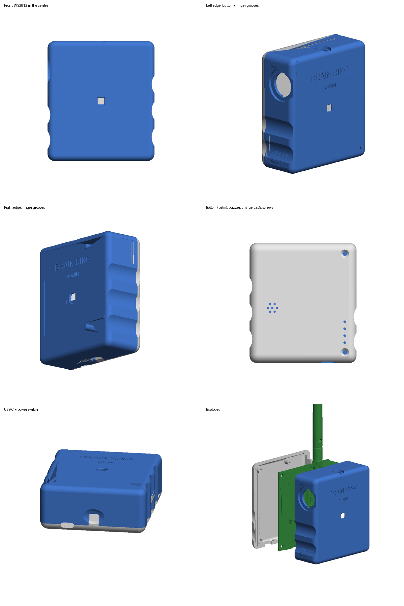

# Корпус пульта ведущего (Admin), v2

Параметрическая модель: `brw_admin_case.py` (Python + build123d). Готовые файлы — в `../print/v2/`:

| Файл | Что это |
|---|---|
| `Case_BRw_admin.step / .stl` | Основная часть с лицевой стороной: WS2812 по центру, кнопка, антенна, USB-C, выключатель |
| `Cap_BRw_admin.step / .stl` | Нижняя крышка (в ладони): винты, решётка баззера, световоды индикаторов заряда |
| `Case_BRw_admin_art_blue / _yellow / _black.stl` | Цветные вставки лицевой панели (рисунок K5), заподлицо, глубина 0.6 мм |
| `Case_BRw_admin_color.step` | Корпус + вставки одним файлом (для CAD) |
| `BRw_admin_assembly.step` | Сборка корпуса с платой Rev. 2.1 для проверки в SolidWorks |



## Компоновка
- Начало координат — центр платы, Z = 0 — нижняя (паечная) сторона платы. Все файлы в одной системе координат, в SolidWorks вставлять в начало координат.
- **К пользователю — сторона компонентов**: адресный светодиод в центре лицевой панели.
- **Нижняя сторона платы лежит в ладони**: баззер и индикаторы IP5305 (D2–D5) смотрят вниз, через крышку; винты тоже снизу.
- Кнопка 20 мм — на левом торце, сдвинута к антенному концу (центр в 21 мм от верхнего торца), поднята к лицевой стороне (проходит над модулем LGT): под указательный палец правой руки или большой палец левой. Отверстие Ø17.3 с двумя пазами 4.2 мм под ушки-защёлки (вдоль длинной стороны), пазы оставляют ~0.65 мм на защёлкивание. Вокруг — площадка-углубление, стенка 2 мм.
- Окно светодиода квадратное 5 × 5 мм (с фаской 0.3): снаружи виден только корпус 5050.
- Выемки под пальцы с обеих сторон (R11, глубина 2 мм): три на правом торце, две на левом под кнопкой — удобно и правше, и левше.
- Вырез USB-C 10 × 4.4 мм, нижняя стенка обычной толщины (3.1 мм). Вокруг ползунка выключателя — пологая овальная лунка под палец (до 1.6 мм), паз со скруглёнными углами; снизу паз закрывает зуб нижней крышки заподлицо со стенкой.
- Антенна выходит по центру верхнего торца.
- Габарит 76.6 × 86 × 33.6 мм.

## Крепёж
- **Слева (H1, H2)**: 2 винта M3×12 потай со стороны ладони, через крышку и плату, в латунные вплавляемые вставки M3 (Ø4.2 × 4 мм) в бобышках корпуса Ø8.5. Гнездо под вставку Ø4.0, глубина 4.8 мм. Отверстия H1/H2 в плате — Ø3.2.
- **Справа**: 3 защёлки. На крышке жёсткие язычки с зубом 0.7 мм, они входят в пазы стенки корпуса. Карманы под зубья вырезаны по дуге поворота крышки, снаружи стенка над карманом 1.2 мм.
- **H3, H4**: без винтов. Стойки корпуса прижимают плату к крышке, штырьки крышки Ø1.9 входят в отверстия платы.

## Порядок сборки
0. Вплавить 2 вставки M3 в бобышки H1/H2 корпуса (паяльник ~220 °C для PLA / ~240 °C для PETG), заподлицо с торцом бобышки.
1. Вставить WS2812 (Ø10 × 2.2 мм) в гнездо под лицевой панелью светом наружу, до упора в окно, повернуть так, чтобы квадрат 5050 совпал с квадратным окном, приклеить; провода — через вырез в кольце к J1.
2. Кнопку 20 мм вставить снаружи до упора фланцем (ушки в пазы, вдоль длинной стороны корпуса), провода к J1.
3. Плату (без nRF-модуля) вложить в корпус компонентами к лицевой панели.
4. nRF-модуль: сначала SMA в отверстие верхнего торца (немного наклонив), затем посадить на гребёнку.
5. Крышку завести правым краем под наклоном ~12°: зубья язычков входят в карманы стенки. Повернуть крышку вокруг правого шва до закрытия и закрутить 2 винта M3 слева. Накрутить антенну.

## Печать
- Case — лицевой стороной на стол; Cap — наружной стороной на стол. Поддержки по желанию только под свод отверстия кнопки.
- PETG/PLA, 3 периметра, слой 0.2 мм.

## Цветная печать лицевой панели (Bambu Lab A1 + AMS lite)
Рисунок K5: синяя рамка, точки, BRAIN / RING с чёрной тенью, жёлтая «звезда» с чёрным кантом вокруг светодиода, ADMIN. Корпус белый.
1. В Bambu Studio выделить сразу 4 файла: `Case_BRw_admin.stl` + `Case_BRw_admin_art_blue.stl`, `_yellow.stl`, `_black.stl` и перетащить в окно.
   На вопрос «загрузить как один объект с несколькими частями?» ответить **Да**.
2. В списке объектов назначить частям филамент: корпус — белый, `art_blue` — синий, `art_yellow` — жёлтый, `art_black` — чёрный.
3. Положить лицевой стороной на стол (как обычно для Case): весь рисунок окажется в первых 3 слоях (0.6 мм) и выйдет ровным по текстуре стола.
   Смена цвета нужна только на этих 3 слоях — дальше печатается один белый.
4. Чёрный круг Ø9.2 в центре «звезды» проходит на всю толщину крыши над светодиодом (0.6 мм), так что вокруг окна почти нет паразитной подсветки сквозь белый пластик.
Если печатать корпус одним цветом, без вставок, рисунок останется углублениями 0.6 мм.

## Параметры
Все размеры — константы в начале скрипта (`LED_D`, `LED_H` — круглая плата WS2812, `BTN_*` — кнопка, `GRIP_*` — выемки, `USB_*` — вырез). Пересборка:

```
python brw_admin_case.py path/to/board.step   # board.step: kicad-cli pcb export step ...
```
